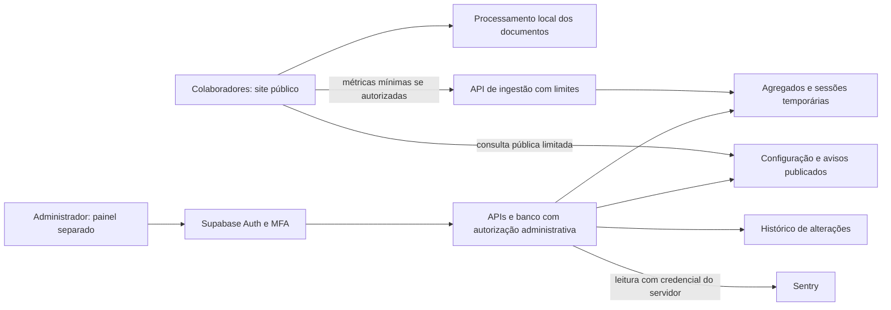

# CentralPDF — plano do painel administrativo

**Proposta para avaliação · 30/10/2026 · versão 1.0**  
Estado: planejamento e protótipo demonstrativo. Nenhum serviço, login real ou alteração no site foi implantado.

## 1. Decisão de produto

Criar uma área privada para o responsável acompanhar e administrar o CentralPDF. O site de ferramentas permanece público: os colegas não precisam de cadastro. PDFs e imagens continuam sendo processados nos dispositivos dos usuários.

O painel terá endereço separado, identidade visual do CentralPDF e modos claro/escuro. O protótipo usa dados fictícios e funciona sem rede, contas, bibliotecas externas ou acesso ao Sentry. Ele serve para avaliar organização, aparência e interações; não demonstra segurança de autenticação.

**Benefícios esperados:** identificar ferramentas mais úteis, priorizar falhas recorrentes, comunicar orientações e reduzir a necessidade de editar código para ajustes operacionais simples. Resultados dependem da cobertura da coleta; indicadores não representam necessariamente toda a utilização.

## 2. Evidência atual e limites

- Site público: GitHub Pages; entrega de HTML, CSS, JavaScript e motores. Não há processamento compartilhado de PDFs no servidor.
- A avaliação local de 30/10/2026 exercitou lotes de 2, 5, 10 e 20 contextos Chromium simultâneos. As 37 sessões juntaram PDFs sintéticos de 3 + 2 páginas e validaram a saída de 5 páginas com PDFLib e PDF.js, sem falhas ou mistura de conteúdo.
- A maior rodada teve 20 sessões. Isso não é um teto de produção, teste de OCR pesado ou prova de capacidade do GitHub Pages. O teste compartilhou um ambiente de 2 CPUs e 8 GiB; computadores diferentes distribuem recursos de outra forma.
- O GitHub publica limite mensal flexível de 100 GB e possibilidade de limitação de requisições. Não fornece, nesse documento, uma capacidade garantida em pessoas simultâneas.
- Sentry reúne categorias de erros e traces opcionais, com limites e possibilidade de desativação. Ele não fornece um censo de pessoas ou acessos completos nesta integração.

Fontes: [GitHub Pages](https://docs.github.com/en/pages/getting-started-with-github-pages/github-pages-limits), [Supabase Auth](https://supabase.com/docs/guides/auth), [RLS](https://supabase.com/docs/guides/database/postgres/row-level-security), [changelog Supabase](https://supabase.com/changelog).

## 3. Experiência proposta

| Área | Conteúdo e ações | Benefício | Entrega |
|---|---|---|---|
| Visão geral | Sessões ativas estimadas, processamentos registrados, conclusão, falhas e evolução por período | Entender a demanda e perceber mudanças | MVP |
| Ferramentas | Busca, volume registrado, sucesso e falhas por ferramenta | Priorizar melhorias | MVP |
| Diagnósticos | Categorias, versão, ferramenta e link ao Sentry; filtros e detalhes | Investigar recorrências | MVP |
| Avisos | Rascunho, prévia e publicação de mensagem textual | Orientar a equipe no próprio app | MVP |
| Ajustes | Preferências públicas permitidas e versionadas | Ajustar o comportamento online com segurança | Após validar o MVP |
| Histórico | Autor, horário, ação, objeto e revisão de cada alteração | Rastreabilidade e recuperação | MVP |
| Acesso | Login exclusivo do administrador, recuperação e segundo fator | Proteger dados e controles | MVP obrigatório |

A tela inicial deve apresentar poucos indicadores com definições claras. “Sessões ativas” significa abas que enviaram atividade recentemente, não pessoas identificadas. Falta de dados deve aparecer como “Sem dados”, nunca como zero confirmado. Serviços não conectados devem aparecer como tal, sem selos de saúde falsos.

## 4. Escopo do primeiro lançamento

### Incluído

1. Uma conta administrativa provisionada, sem cadastro público pelo painel.
2. Login, saída, recuperação de conta e MFA; nenhuma senha implementada ou guardada no JavaScript do site.
3. Visão geral e tabela de ferramentas com períodos “Hoje” e “Últimos 7 dias”, estados de carregamento, vazio e indisponibilidade.
4. Integração de leitura com o projeto Sentry existente, por backend, ou ligação ao painel privado enquanto a API não estiver configurada.
5. Avisos simples: texto, nível, período de vigência, prévia, publicação e retirada.
6. Histórico de alterações administrativas e cópia da configuração anterior para recuperação.
7. Métricas mínimas, proteção contra abuso e orçamento de uso dos serviços.

### Fora do primeiro lançamento

Contas de colegas, nomes de visitantes, acompanhamento de documentos, uploads centrais, gravação de sessões, faturamento, edição remota de código, assinatura digital, bloqueio irreversível de ferramentas e atualização forçada de cópias offline. O painel não substitui revisão de código, PRs, testes ou o processo de publicação atual.

## 5. Arquitetura recomendada

- **Site atual:** permanece no GitHub Pages, com os motores e arquivos locais existentes.
- **Painel:** aplicação separada, preferencialmente React + Vite + TypeScript, hospedada em serviço adequado a uma área autenticada. A escolha final entre provedores ocorre antes de configurar contas ou domínios.
- **Autenticação/banco:** Supabase Auth e PostgreSQL com RLS, em projeto dedicado ou ambiente separado. Revisar documentação e changelog novamente na implementação.
- **APIs:** funções de backend para validação de métricas, ações administrativas, publicação de configuração e leitura limitada do Sentry.
- **Segredos:** credencial Sentry de leitura e chaves privilegiadas somente no backend. O navegador recebe apenas configuração pública e a chave publicável apropriada; essa chave não substitui RLS.
- **Disponibilidade:** falha no painel, banco ou métricas não pode impedir o uso das ferramentas. A configuração pública tem timeout curto, cache, revisão e valores locais de reserva.

O painel não será incorporado ao app React experimental existente por conveniência: o escopo desse app e sua publicação devem permanecer independentes. A implementação futura pode compartilhar componentes sem alterar o produto público inadvertidamente.

## 6. Dados, privacidade e indicadores

### O que pode ser registrado

Ferramenta de uma lista conhecida, resultado técnico de uma lista conhecida, versão do app, versão do esquema e horário/intervalo de coleta. Duração somente quando a autorização de desempenho aplicável estiver ativa. Para atividade estimada, identificador aleatório temporário da aba, sem identidade persistente.

### O que fica fora

Bytes ou conteúdo dos arquivos, nomes de documentos, texto digitado, caminhos, nomes/e-mails dos colegas, URLs completas, credenciais, IP em relatórios analíticos e identificação de equipamentos. O receptor e os provedores ainda observam metadados de conexão necessários, como IP; não prometer anonimato absoluto.

### Política recomendada

- Manter a escolha existente de erros automáticos com opção de desativação.
- Acrescentar uma autorização clara e separada para novas estatísticas de uso; não converter silenciosamente a permissão de erros em coleta ampla.
- Métricas de desempenho continuam respeitando autorização própria e amostragem.
- Sessão ativa: atividade de aba visível a cada 60 segundos; expiração sugerida de 3 minutos; interromper ao ocultar a aba ou revogar a coleta.
- Retenção inicial sugerida: eventos de uso até 7 dias; agregados diários por 90 dias; histórico administrativo por 180 dias. Confirmar a necessidade e automatizar a exclusão antes de produção.
- A tela informa cobertura parcial, fonte, período e última atualização. Não confundir pessoas únicas, abas, eventos registrados ou ocorrências agrupadas.

**Definições:** conclusão = operações concluídas / operações com resultado registrado. Falhas são resultados técnicos, não usuários afetados. Abandono ou fechamento da aba pode impedir o registro final. Usuários offline, bloqueadores e desativações reduzem a cobertura. O volume anônimo pode ser falsificado; não deve ser usado para cobrança ou decisões de segurança.

## 7. Modelo de dados inicial

| Entidade | Campos principais | Acesso |
|---|---|---|
| Administradores | Identidade Auth e papel administrativo emitido por fonte confiável | Backend/administrador autorizado |
| Sessões temporárias | ID efêmero, última atividade, expiração | Ingestão validada; leitura administrativa |
| Eventos técnicos | Ferramenta, resultado, versão, esquema, intervalo | Entrada por API limitada; leitura administrativa |
| Agregados diários | Dia, ferramenta, totais e cobertura | Leitura administrativa |
| Avisos | Texto simples, nível, estado, início/fim, revisão | Escrita administrativa; somente publicados na API pública |
| Configuração | Chaves permitidas, revisão e valores | Escrita administrativa; projeção pública limitada |
| Auditoria | Administrador, ação, objeto, revisão e horário | Backend grava; administrador consulta |

Não haverá leitura pública dos eventos, sessões, auditoria ou rascunhos. Não permitir inserção anônima direta em tabelas analíticas. Views expostas devem respeitar a política de acesso. Permissões administrativas não serão derivadas de dados que o próprio usuário possa editar.

## 8. Requisitos de segurança e operação

- Validar autenticação, papel administrativo e MFA no backend e nas políticas de banco; esconder um menu não é autorização.
- Desabilitar o cadastro público administrativo; testar conta autenticada sem papel, sessão expirada, saída e recuperação.
- Planejar revogação de sessões e o prazo de validade dos tokens. Remover uma conta, por si só, não invalida todos os tokens já emitidos.
- Habilitar RLS nas tabelas expostas, com permissões e políticas mínimas de leitura/escrita. Não usar chave privilegiada no frontend nem funções públicas que contornem a autorização.
- Validar listas de campos, tipos, tamanho e versão na ingestão. CORS/origem, sozinhos, não autenticam eventos.
- Aplicar limites de requisições, teto global de ingestão e alertas de quota. Tratar contagem de sessões como estimativa sujeita a abuso.
- Avisos são texto simples. Links, se incluídos posteriormente, precisam de validação. Configurações não podem carregar código remoto ou HTML arbitrário.
- Gravar alteração e auditoria de maneira consistente. Usar revisão para evitar que duas abas sobrescrevam uma mudança silenciosamente.
- Registro e métricas não podem bloquear processamento local nem gerar fila durável ilimitada de dados.
- Separar homologação/produção. Controlar acesso às contas, backups, retenção e responsáveis por alertas.

## 9. Limites do controle remoto

Avisos e ajustes alcançam clientes online compatíveis quando eles consultam a configuração. Versões antigas, abas já abertas e cópias offline podem continuar usando valores anteriores. Visibilidade de uma ferramenta não é bloqueio de segurança: o código já distribuído continua no computador do usuário.

Não haverá botão de “atualizar todos os computadores”, acesso aos documentos da equipe ou publicação automática de código. Uma versão do aplicativo continua passando pelo fluxo atual de revisão, testes e publicação. Um aviso urgente precisa também de um canal de comunicação da equipe.

## 10. Etapas e critérios de aceite

| Etapa | Entrega | Critério para avançar |
|---|---|---|
| 0 — proposta atual | Plano, protótipo navegável e revisão visual | Responsável aprova escopo e organização; dados fictícios identificados |
| 1 — fundação privada | Ambiente de homologação, Auth, MFA, permissões e auditoria | Visitante e conta não administrativa não leem nem alteram dados privados |
| 2 — observabilidade | Ingestão mínima, agregados, visão geral e integração Sentry | Contadores consistentes com fixtures, filtros corretos e falha de rede sem impacto no app |
| 3 — comunicação | Avisos com prévia, vigência e retirada | Somente versão publicada aparece no cliente; rascunho nunca é público |
| 4 — piloto | Grupo pequeno em computadores reais, acessibilidade, quotas e contingência | Casos de uso aprovados, ausência de dados de documentos e recuperação exercitada |
| 5 — implantação | Publicação separada e acompanhamento | Aprovação específica de implantação; monitoramento e responsável definidos |
| 6 — evolução | Ajustes globais permitidos e relatórios adicionais | Necessidade demonstrada e políticas de acesso preservadas |

Estimativa preliminar de implementação do MVP: **10 a 17 dias úteis de esforço**, após aprovação de escopo e disponibilidade dos serviços. Não é compromisso de prazo. Pode variar conforme integração Sentry, requisitos de MFA, infraestrutura, revisão e feedback. Etapa 0 não configura serviços externos.

## 11. Testes e acompanhamento

- Unidade: validação, agregação, datas, estados de avisos e revisão de configuração.
- Segurança: acesso anônimo, conta comum, papel adulterado, token inválido/expirado, MFA ausente, rascunho privado e segredos fora do bundle.
- Integração: publicação/retirada, auditoria, expiração de sessões, limpeza de retenção e consultas Sentry limitadas ao projeto autorizado.
- Interface: claro/escuro, teclado, foco, 1440×1000, 1366×768 e 390×844, Chromium/Firefox; incluir Safari e tecnologias assistivas antes de declarar suporte verificado.
- Resiliência: offline, timeout, quotas, serviço indisponível, configuração antiga e payload inválido. O app público deve continuar processando arquivos.
- Carga: separar downloads do site, processamento no dispositivo e API de métricas. Ensaiar 20/50/100 sessões em homologação com volume controlado; dimensionar a partir do piloto, sem extrapolar a avaliação local como capacidade garantida.
- Aceite de privacidade: inspecionar pedidos reais com documentos sintéticos e confirmar ausência de nomes/conteúdo; validar limpeza e retenção no provedor.

## 12. Custos e decisões pendentes

Não é necessário contratar nada para avaliar este protótipo. Na implementação, verificar preços/quotas vigentes de hospedagem, Auth, banco, funções, e-mail e Sentry. O principal dimensionamento novo será o volume de eventos e a retenção, não o processamento de PDFs. Adotar orçamento e alertas antes do piloto; não prometer custo zero permanente.

Decisões para a próxima etapa: aprovação do MVP, provedor/endereço do painel, projeto Supabase, recuperação da conta/MFA, acesso Sentry de leitura, política das novas métricas e responsáveis operacionais. Não compartilhar senha administrativa ou chaves secretas nesta conversa.

## 13. Como avaliar o exemplo

Abra `examples/admin-demo/index.html` no navegador ou use o servidor de prévia indicado na PR. Não exige instalação nem rede. Experimente períodos, menus, temas, busca de ferramentas, detalhes de falhas, prévia de aviso e ajustes demonstrativos. “Salvar” afeta somente a memória desta aba; recarregar restaura o exemplo. A tela de acesso é ilustrativa e não recebe credenciais.

Todos os números e serviços do exemplo são fictícios. O documento deste plano, a evidência local de capacidade e os dados do protótipo têm finalidades distintas. Nenhum deles deve ser apresentado como uma medição real de uso da equipe.
