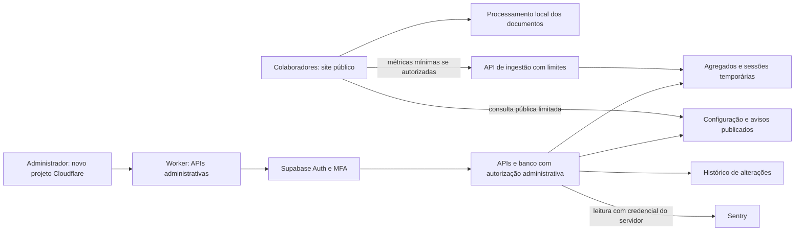

# CentralPDF — plano do painel administrativo

**Proposta para avaliação · 30/10/2026 · versão 1.1**

Estado: revisão de planejamento. Nenhum serviço, login real, recurso Cloudflare ou alteração no site/protótipo foi implantado nesta revisão. O exemplo navegável anterior continua ilustrativo.

## 1. Decisão de produto

Criar uma área privada para o responsável acompanhar e administrar o CentralPDF. O site de ferramentas permanece público: os colegas não precisam de cadastro. PDFs e imagens continuam sendo processados nos dispositivos dos usuários.

O painel terá endereço separado na Cloudflare, em um **projeto novo e exclusivo do CentralPDF**, com identidade visual própria e modos claro/escuro. O projeto **Omni fica fora do escopo**: não reutilizar seus recursos nem alterar sua configuração, seus dados ou sua publicação. O protótipo usa dados fictícios e funciona sem rede, contas, bibliotecas externas ou acesso ao Sentry. Ele serve para avaliar organização, aparência e interações; não demonstra segurança de autenticação.

**Benefícios esperados:** identificar ferramentas mais úteis, priorizar falhas recorrentes, comunicar orientações e reduzir a necessidade de editar código para ajustes operacionais simples. Resultados dependem da cobertura da coleta; indicadores não representam necessariamente toda a utilização.

## 2. Evidência atual e limites

- Site público: GitHub Pages; entrega de HTML, CSS, JavaScript e motores. Não há processamento compartilhado de PDFs no servidor.
- A avaliação local de 30/10/2026 exercitou lotes de 2, 5, 10 e 20 contextos Chromium simultâneos. As 37 sessões juntaram PDFs sintéticos de 3 + 2 páginas e validaram a saída de 5 páginas com PDFLib e PDF.js, sem falhas ou mistura de conteúdo.
- A maior rodada teve 20 sessões. Isso não é um teto de produção, teste de OCR pesado ou prova de capacidade do GitHub Pages. O teste compartilhou um ambiente de 2 CPUs e 8 GiB; computadores diferentes distribuem recursos de outra forma.
- O GitHub publica limite mensal flexível de 100 GB e possibilidade de limitação de requisições. Não fornece, nesse documento, uma capacidade garantida em pessoas simultâneas.
- Sentry reúne categorias de erros e traces opcionais, com limites e possibilidade de desativação. Ele não fornece um censo de pessoas ou acessos completos nesta integração.

Fontes: [GitHub Pages](https://docs.github.com/en/pages/getting-started-with-github-pages/github-pages-limits), [Supabase Auth](https://supabase.com/docs/guides/auth), [RLS](https://supabase.com/docs/guides/database/postgres/row-level-security), [changelog Supabase](https://supabase.com/changelog).

## 3. Experiência proposta

| Área | Conteúdo e ações | Benefício | Entrega |
|---|---|---|---|
| Visão geral | Sessões ativas estimadas, processamentos registrados, conclusão, falhas e evolução por período | Entender a demanda e perceber mudanças | MVP |
| Ferramentas | Busca, volume registrado, sucesso e falhas por ferramenta | Priorizar melhorias | MVP |
| Diagnósticos | Categorias, versão, ferramenta e link ao Sentry; filtros e detalhes | Investigar recorrências | MVP |
| Avisos | Rascunho, prévia e publicação de mensagem textual | Orientar a equipe no próprio app | MVP |
| Ajustes | Preferências públicas permitidas e versionadas | Ajustar o comportamento online com segurança | Após validar o MVP |
| Histórico | Autor, horário, ação, objeto e revisão de cada alteração | Rastreabilidade e recuperação | MVP |
| Acesso | Login exclusivo do administrador, recuperação e segundo fator | Proteger dados e controles | MVP obrigatório |

A tela inicial deve apresentar poucos indicadores com definições claras. “Sessões ativas” significa abas que enviaram atividade recentemente, não pessoas identificadas. Falta de dados deve aparecer como “Sem dados”, nunca como zero confirmado. Serviços não conectados devem aparecer como tal, sem selos de saúde falsos.

## 4. Escopo do primeiro lançamento

### Incluído

1. Uma conta administrativa provisionada, sem cadastro público pelo painel.
2. Login, saída, primeiro acesso seguro, recuperação na tela de entrada, alteração de senha dentro do painel e MFA; nenhuma senha implementada ou guardada no JavaScript do site.
3. Visão geral e tabela de ferramentas com períodos “Hoje” e “Últimos 7 dias”, estados de carregamento, vazio e indisponibilidade.
4. Integração de leitura com o projeto Sentry existente, por backend, ou ligação ao painel privado enquanto a API não estiver configurada.
5. Avisos simples: texto, nível, período de vigência, prévia, publicação e retirada.
6. Histórico de alterações administrativas e cópia da configuração anterior para recuperação.
7. Métricas mínimas, proteção contra abuso e orçamento de uso dos serviços.
8. Futuro cartão “Área do administrador” no diagnóstico do app público, imediatamente após “Capacidade estimada”, conforme a referência do responsável.

### Fora do primeiro lançamento

Contas de colegas, nomes de visitantes, acompanhamento de documentos, uploads centrais, gravação de sessões, faturamento, edição remota de código, assinatura digital, bloqueio irreversível de ferramentas e atualização forçada de cópias offline. O painel não substitui revisão de código, PRs, testes ou o processo de publicação atual.

## 5. Arquitetura recomendada



- **Site atual:** permanece no GitHub Pages, com os motores e arquivos locais existentes.
- **Painel:** aplicação separada, preferencialmente React + Vite + TypeScript, em **novo projeto Cloudflare Workers com Static Assets**. Nome sugerido: `centralpdf-admin`, sujeito a disponibilidade. Nenhum recurso foi criado; a conexão de leitura à conta foi confirmada, mas endereço, permissões de implantação e configuração ainda dependem de validação. O nome sugerido não apareceu no inventário consultado, sem reserva de disponibilidade futura.
- **Autenticação/banco:** Supabase Auth e PostgreSQL com RLS, em projeto dedicado ou ambiente separado. Revisar documentação e changelog novamente na implementação.
- **APIs:** Cloudflare Worker dedicado para validação de métricas, ações administrativas, publicação de configuração e leitura limitada do projeto Sentry do CentralPDF. Rotas privadas precisam passar pela validação do backend, inclusive em hostnames alternativos e prévias; o fallback de SPA não pode contornar essa proteção.
- **Segredos:** credencial Sentry de leitura e chaves privilegiadas somente no backend. O navegador recebe apenas configuração pública e a chave publicável apropriada; essa chave não substitui RLS.
- **Isolamento:** projeto, bindings, secrets, variáveis, banco, integração de repositório e fluxos de implantação específicos do CentralPDF; nada compartilhado ou modificado no Omni. Verificar separadamente limites/faturamento da conta: criar um projeto novo não demonstra isolamento de todas as quotas.
- **Disponibilidade:** falha no painel, banco ou métricas não pode impedir o uso das ferramentas. A configuração pública tem timeout curto, cache, revisão e valores locais de reserva.

A Cloudflare hospeda e executa o painel/API; não substitui automaticamente o provedor de identidade. Supabase permanece a recomendação para e-mail/senha, recuperação e banco com RLS. Cloudflare Access com Google ou PIN por e-mail é uma alternativa de acesso, mas não equivale a manter uma senha própria com redefinição dentro do app. A comparação e as condições constam na seção 16.

O painel não será incorporado ao app React experimental existente por conveniência: o escopo desse app e sua publicação devem permanecer independentes. A implementação futura pode compartilhar componentes sem alterar o produto público inadvertidamente.

## 6. Dados, privacidade e indicadores

### O que pode ser registrado

Ferramenta de uma lista conhecida, resultado técnico de uma lista conhecida, versão do app, versão do esquema e horário/intervalo de coleta. Duração somente quando a autorização de desempenho aplicável estiver ativa. Para atividade estimada, identificador aleatório temporário da aba, sem identidade persistente.

### O que fica fora

Bytes ou conteúdo dos arquivos, nomes de documentos, texto digitado, caminhos, nomes/e-mails dos colegas, URLs completas, credenciais, IP em relatórios analíticos e identificação de equipamentos. O receptor e os provedores ainda observam metadados de conexão necessários, como IP; não prometer anonimato absoluto.

### Política recomendada

- Manter a escolha existente de erros automáticos com opção de desativação.
- Acrescentar uma autorização clara e separada para novas estatísticas de uso; não converter silenciosamente a permissão de erros em coleta ampla.
- Métricas de desempenho continuam respeitando autorização própria e amostragem.
- Sessão ativa: atividade de aba visível a cada 60 segundos; expiração sugerida de 3 minutos; interromper ao ocultar a aba ou revogar a coleta.
- Retenção inicial sugerida: eventos de uso até 7 dias; agregados diários por 90 dias; histórico administrativo por 180 dias. Confirmar a necessidade e automatizar a exclusão antes de produção.
- A tela informa cobertura parcial, fonte, período e última atualização. Não confundir pessoas únicas, abas, eventos registrados ou ocorrências agrupadas.

**Definições:** conclusão = operações concluídas / operações com resultado registrado. Falhas são resultados técnicos, não usuários afetados. Abandono ou fechamento da aba pode impedir o registro final. Usuários offline, bloqueadores e desativações reduzem a cobertura. O volume anônimo pode ser falsificado; não deve ser usado para cobrança ou decisões de segurança.

## 7. Modelo de dados inicial

| Entidade | Campos principais | Acesso |
|---|---|---|
| Administradores | Identidade Auth e papel administrativo emitido por fonte confiável | Backend/administrador autorizado |
| Sessões temporárias | ID efêmero, última atividade, expiração | Ingestão validada; leitura administrativa |
| Eventos técnicos | Ferramenta, resultado, versão, esquema, intervalo | Entrada por API limitada; leitura administrativa |
| Agregados diários | Dia, ferramenta, totais e cobertura | Leitura administrativa |
| Avisos | Texto simples, nível, estado, início/fim, revisão | Escrita administrativa; somente publicados na API pública |
| Configuração | Chaves permitidas, revisão e valores | Escrita administrativa; projeção pública limitada |
| Auditoria | Administrador, ação, objeto, revisão e horário | Backend grava; administrador consulta |

Não haverá leitura pública dos eventos, sessões, auditoria ou rascunhos. Não permitir inserção anônima direta em tabelas analíticas. Views expostas devem respeitar a política de acesso. Permissões administrativas não serão derivadas de dados que o próprio usuário possa editar.

## 8. Requisitos de segurança e operação

- Validar autenticação, papel administrativo e MFA no backend e nas políticas de banco; esconder um menu não é autorização.
- Desabilitar o cadastro público administrativo; testar conta autenticada sem papel, sessão expirada, saída e recuperação. A identidade administrativa foi informada pelo responsável e deve ser provisionada privadamente no Auth, sem expor o e-mail completo no bundle ou neste documento público.
- Planejar revogação de sessões e o prazo de validade dos tokens. Remover uma conta, por si só, não invalida todos os tokens já emitidos.
- Habilitar RLS nas tabelas expostas, com permissões e políticas mínimas de leitura/escrita. Não usar chave privilegiada no frontend nem funções públicas que contornem a autorização.
- Validar listas de campos, tipos, tamanho e versão na ingestão. CORS/origem, sozinhos, não autenticam eventos.
- Aplicar limites de requisições, teto global de ingestão e alertas de quota. Tratar contagem de sessões como estimativa sujeita a abuso.
- Avisos são texto simples. Links, se incluídos posteriormente, precisam de validação. Configurações não podem carregar código remoto ou HTML arbitrário.
- Gravar alteração e auditoria de maneira consistente. Usar revisão para evitar que duas abas sobrescrevam uma mudança silenciosamente.
- Registro e métricas não podem bloquear processamento local nem gerar fila durável ilimitada de dados.
- Separar homologação/produção. Controlar acesso às contas, backups, retenção e responsáveis por alertas. A autorização concedida para a conta Cloudflare não amplia o escopo atual: esta etapa não cria recursos, altera DNS, faz deploy ou envia e-mails.
- Definir o modelo de sessão antes do código: preferência por uma camada de backend no Worker para operações administrativas, cookies seguros quando aplicáveis, validação de tokens e proteção CSRF/origem. Não confiar apenas em ler um token no navegador.
- Respostas administrativas, recuperação e sessões não podem ser armazenadas como conteúdo público na CDN. Restringir callbacks aos endereços HTTPS oficiais; jamais registrar senhas, tokens ou links completos de recuperação nos logs.

## 9. Limites do controle remoto

Avisos e ajustes alcançam clientes online compatíveis quando eles consultam a configuração. Versões antigas, abas já abertas e cópias offline podem continuar usando valores anteriores. Visibilidade de uma ferramenta não é bloqueio de segurança: o código já distribuído continua no computador do usuário.

Não haverá botão de “atualizar todos os computadores”, acesso aos documentos da equipe ou publicação automática de código. Uma versão do aplicativo continua passando pelo fluxo atual de revisão, testes e publicação. Um aviso urgente precisa também de um canal de comunicação da equipe.

## 10. Etapas e critérios de aceite

| Etapa | Entrega | Critério para avançar |
|---|---|---|
| 0 — proposta atual | Plano revisto para novo projeto Cloudflare, primeiro acesso, redefinição e posição do cartão | Responsável aprova as decisões; Omni e site atual permanecem intactos |
| 1 — fundação privada | Após aprovação: novo projeto Cloudflare, homologação, Auth, MFA, permissões, envio de recuperação e auditoria | Visitante e conta não administrativa não leem nem alteram dados privados; isolamento do Omni verificado |
| 2 — observabilidade | Ingestão mínima, agregados, visão geral e integração Sentry | Contadores consistentes com fixtures, filtros corretos e falha de rede sem impacto no app |
| 3 — comunicação | Avisos com prévia, vigência e retirada | Somente versão publicada aparece no cliente; rascunho nunca é público |
| 4 — piloto | Cartão de acesso no diagnóstico, grupo pequeno em computadores reais, acessibilidade, quotas e contingência | Localização conforme a referência, recuperação efetiva e nenhuma mudança no Omni |
| 5 — implantação | Publicação separada e acompanhamento | Aprovação específica de implantação; monitoramento e responsável definidos |
| 6 — evolução | Ajustes globais permitidos e relatórios adicionais | Necessidade demonstrada e políticas de acesso preservadas |

Estimativa preliminar de implementação do MVP: **10 a 17 dias úteis de esforço**, após aprovação de escopo e disponibilidade dos serviços. Não é compromisso de prazo. Pode variar conforme integração Sentry, requisitos de MFA, infraestrutura, revisão e feedback. Etapa 0 não configura serviços externos. A estimativa precisa ser revista após confirmar conta/plano Cloudflare, projeto Auth e envio de recuperação; ter um projeto Omni existente não comprova essas condições para o novo projeto.

## 11. Testes e acompanhamento

- Unidade: validação, agregação, datas, estados de avisos e revisão de configuração.
- Segurança: acesso anônimo, conta comum, papel adulterado, token inválido/expirado, MFA ausente, rascunho privado, proteção nos hostnames alternativos e segredos fora do bundle.
- Recuperação: primeiro acesso, link usado/expirado, destino de redirecionamento adulterado, conta não permitida, mensagem genérica contra enumeração, entrega de e-mail, alteração autenticada e revogação de sessões conforme a política.
- Isolamento: comparar recursos/rotas/bindings do Omni antes e depois da futura implantação, sem modificá-los; verificar que o novo projeto não reutiliza seu banco ou seus secrets.
- Integração: publicação/retirada, auditoria, expiração de sessões, limpeza de retenção e consultas Sentry limitadas ao projeto autorizado.
- Interface: claro/escuro, teclado, foco, 1440×1000, 1366×768 e 390×844, Chromium/Firefox; incluir Safari e tecnologias assistivas antes de declarar suporte verificado.
- Resiliência: offline, timeout, quotas, serviço indisponível, configuração antiga e payload inválido. O app público deve continuar processando arquivos.
- Carga: separar downloads do site, processamento no dispositivo e API de métricas. Ensaiar 20/50/100 sessões em homologação com volume controlado; dimensionar a partir do piloto, sem extrapolar a avaliação local como capacidade garantida.
- Aceite de privacidade: inspecionar pedidos reais com documentos sintéticos e confirmar ausência de nomes/conteúdo; validar limpeza e retenção no provedor.

## 12. Custos e decisões pendentes

Não é necessário contratar nada para avaliar este protótipo. Na implementação, verificar preços/quotas vigentes de hospedagem, Auth, banco, funções, e-mail e Sentry. O principal dimensionamento novo será o volume de eventos e a retenção, não o processamento de PDFs. Adotar orçamento e alertas antes do piloto; não prometer custo zero permanente.

Decisões para a próxima etapa: aprovação do MVP, confirmação de plano/limites e permissões específicas da conta Cloudflare, nome/endereço do novo projeto, projeto Supabase, método de primeiro acesso, envio de recuperação/MFA, acesso Sentry de leitura, política das novas métricas, limites compartilhados da conta e responsáveis operacionais. O Omni não é candidato a reaproveitamento. Não compartilhar senha administrativa ou chaves secretas nesta conversa.

## 13. Como avaliar o exemplo

Abra `examples/admin-demo/index.html` no navegador ou use o servidor de prévia indicado na PR. Não exige instalação nem rede. Experimente períodos, menus, temas, busca de ferramentas, detalhes de falhas, prévia de aviso e ajustes demonstrativos. “Salvar” afeta somente a memória desta aba; recarregar restaura o exemplo. A tela de acesso é ilustrativa e não recebe credenciais.

Todos os números e serviços do exemplo são fictícios. O documento deste plano, a evidência local de capacidade e os dados do protótipo têm finalidades distintas. Nenhum deles deve ser apresentado como uma medição real de uso da equipe.


## 14. Local do acesso administrativo no aplicativo

**Referência aprovada pelo responsável:** diálogo **Compatibilidade e modo offline**. O novo cartão fica no final do conteúdo, imediatamente depois de **Capacidade estimada**, que reúne processadores, memória informada e armazenamento local. Não colocar o link dentro dos valores de memória nem substituir os botões de preparar offline/verificar novamente.

Esquema de posição, para planejamento:

```text
[ Capacidade estimada                                      ]
[ Processadores | Memória informada | Armazenamento local  ]

[ Área do administrador                                  ]
[ Acesso exclusivo para acompanhar e gerenciar o CentralPDF. ]
[                       Acessar área do administrador ↗   ]

[ Preparar uso offline ]             [ Verificar novamente ]
```

- Reutilizar a aparência dos cartões existentes, em largura completa; título, descrição curta e uma ação clara. Em telas pequenas, texto e botão se reorganizam sem cortar conteúdo.
- A ação abrirá o endereço HTTPS oficial do novo painel em outra aba, com proteção contra acesso à aba de origem e sem enviar o endereço atual como referência.
- O cartão será visível para todos, mas a conta administrativa e os dados permanecerão protegidos no backend. Encontrar o link não concede acesso.
- Não expor o e-mail administrativo, senha, tokens, nomes de documentos ou parâmetros de autenticação no cartão/URL.
- Não buscar a sessão administrativa nem carregar o painel automaticamente ao abrir o diagnóstico.
- Sem endereço validado, mostrar estado “Em configuração”, sem link fictício. Offline: informar que o painel precisa de internet, mantendo as ferramentas locais disponíveis. Estar online no navegador não comprova acesso ao serviço.
- A capacidade exibida continua sendo uma estimativa do navegador/dispositivo; não representa RAM ou armazenamento da Cloudflare nem consumo de outros colegas.
- Na implementação, preservar foco, Tab/Enter, contraste e os controles atuais do diálogo. O ponto de integração foi identificado em `renderDiagnostics`, no módulo `assets/js/foundation.js`; **nenhuma alteração foi aplicada**.

## 15. Conta administrativa e redefinição de senha

O e-mail administrativo foi definido pelo responsável nesta conversa. Ele será associado à identidade verificada no provedor Auth, em configuração privada. Não reproduzir o endereço completo ou credenciais em documentação pública, frontend, demonstrações ou pacotes para download. Nenhuma conta foi criada nesta revisão.

### Primeiro acesso

Foi solicitada uma senha inicial numérica simples. A análise não recomenda uma sequência previsível para produção: comprimento mínimo, sozinho, não garante força. O valor informado não foi copiado para arquivos, aplicado em serviço ou incorporado ao protótipo.

**Recomendação para aprovação:** convite/link de ativação para o e-mail administrativo, com definição de senha forte pelo responsável e cadastro de MFA antes de liberar operações administrativas. Se houver necessidade de senha temporária, ela deve ser individual, gerada pelo provedor e trocada antes de liberar os controles; não adotar uma senha padrão pública ou compartilhada. A decisão final de primeiro acesso fica pendente da aprovação desta revisão.

### Esqueci minha senha — fora da sessão

1. Link na tela de entrada; resposta genérica, sem revelar se um endereço possui conta.
2. Envio pelo provedor Auth somente para a identidade elegível e verificada, com limites contra abuso.
3. Link de recuperação com validação e validade definida pelo provedor, redirecionando apenas ao host oficial autorizado.
4. Tela para definir e confirmar nova senha, tratamento de link usado/expirado e validação da política escolhida.
5. Reautenticação e tratamento de sessões/MFA conforme a política; alterar senha e recuperar segundo fator são processos distintos.

### Alterar senha — dentro do painel

Em **Conta e segurança**, oferecer alteração de senha, gerenciamento de segundo fator e saída de sessões. Exigir sessão validada e reautenticação adequada para a ação sensível. Registrar apenas que ocorreu uma alteração, nunca a senha, o token ou o conteúdo do link. Manter um procedimento de recuperação do proprietário para perda do segundo fator.

### Pré-requisitos de entrega de e-mail

Configurar e testar o remetente, SMTP/serviço transacional, validade dos links e URLs de callback em homologação. O SMTP padrão de testes do Supabase tem restrições e não é um serviço de produção garantido; não presumir que ele entregará ao endereço administrativo sem configuração. Usar Gmail como destinatário não impede o fluxo, mas não fornece automaticamente um remetente transacional próprio. Hospedar na Cloudflare também não configura esse envio por si só.

Nenhuma mensagem de ativação, redefinição ou teste será enviada nesta etapa de planejamento.

## 16. Viabilidade Cloudflare e isolamento do Omni

| Opção | Atende ao pedido? | Conclusão |
|---|---|---|
| Novo Workers com Static Assets + API Worker + Supabase Auth/Postgres | Sim: frontend, APIs, e-mail/senha, recuperação e dados com autorização | Recomendada para o novo projeto, condicionada à validação dos serviços |
| Novo Pages + Pages Functions + Supabase | Sim, se houver uma razão operacional para escolher Pages | Alternativa compatível; não exige reaproveitar o Omni |
| Cloudflare Access + Google ou PIN por e-mail + armazenamento escolhido | Protege o acesso, mas muda a experiência de senha/redefinição para o provedor de identidade | Alternativa apenas se o responsável aprovar esse modelo; não é a opção base |
| Autenticação própria em Worker/D1 | Tecnicamente possível, com maior responsabilidade por senhas, sessões e recuperação | Não recomendada para o MVP; D1 é banco, não substituto automático de Auth |

**Conclusão:** a plataforma comporta a arquitetura. A viabilidade do projeto específico ainda depende de conta/plano, limites, endereço, integrações, recuperação e validação das permissões. A consulta limitou-se à identidade da conexão e ao inventário nominal de projetos; configurações, conteúdo e dados do Omni não foram consultados ou alterados.

### Limites de isolamento

- **Requisito fechado:** criar um projeto novo para o CentralPDF. Não migrar, renomear, reutilizar, sobrescrever ou fazer deploy no Omni.
- Usar identificadores, repositório/branch de publicação, variáveis, secrets, bindings e ambientes exclusivos do CentralPDF.
- Não reutilizar bancos, buckets, namespaces, rotas, domínios ou políticas do Omni. Qualquer recurso de conta necessário deve ser avaliado pelo possível efeito nos demais projetos antes de ser configurado.
- Começar com endereço próprio do novo projeto, sujeito à disponibilidade. Domínio personalizado é uma decisão posterior, sem alterar rotas de outro aplicativo.
- Confirmar os limites e o orçamento do plano da conta. Um novo nome de projeto não demonstra isolamento de custos, quotas ou políticas compartilhadas.
- Na implantação futura, comprovar que o Omni continua com o mesmo deploy, dados, bindings e rotas; registrar rollback apenas dos recursos novos do CentralPDF.

### O que foi possível verificar agora

Foram consultadas as documentações oficiais atuais de Static Assets, cobrança, Pages Functions, Access, Google/PIN, Supabase Auth, política de senhas, MFA, SMTP e redirects. Elas sustentam a viabilidade da arquitetura e os fluxos descritos.

Em 30/10/2026, o plugin Cloudflare confirmou uma conexão autenticada e acesso de leitura a uma conta. Consultas GET ao inventário encontraram **um projeto Pages, `projeto-omni`, e nenhum Worker**. A listagem Pages informou uma única página, com um resultado. Não foram consultados código, configurações, bindings, secrets, DNS, dados ou logs do Omni.

O nome sugerido `centralpdf-admin` não aparece nesses inventários; isso não o reserva nem garante a disponibilidade do endereço final. Nenhum recurso foi criado e nenhuma chamada de escrita foi executada. A autenticação e as leituras bem-sucedidas não comprovam permissão para futuras ações de implantação.

**Ainda não confirmados:** plano contratado, quotas efetivas e consumo compartilhado, orçamento, subdomínio/endereço final, permissões de escrita necessárias, projeto Supabase, entrega SMTP e integração Sentry de leitura. Não foi solicitado token secreto ao responsável.

### Fontes específicas desta revisão

- [Workers Static Assets](https://developers.cloudflare.com/workers/static-assets/) e [cobrança/limitações](https://developers.cloudflare.com/workers/static-assets/billing-and-limitations/): distinguir entrega de arquivos estáticos de execução cobrada/limitada do Worker; não prometer que todo o backend será gratuito.
- [Pages Functions](https://developers.cloudflare.com/pages/functions/): alternativa para frontend e funções no mesmo projeto novo.
- [Cloudflare Access HTTP](https://developers.cloudflare.com/cloudflare-one/access-controls/applications/http-apps/), [Google](https://developers.cloudflare.com/cloudflare-one/integrations/identity-providers/google/) e [PIN por e-mail](https://developers.cloudflare.com/cloudflare-one/integrations/identity-providers/one-time-pin/): alternativas de identidade, não uma senha padrão própria.
- [Supabase: senhas](https://supabase.com/docs/guides/auth/passwords), [segurança de senhas](https://supabase.com/docs/guides/auth/password-security), [SMTP](https://supabase.com/docs/guides/auth/auth-smtp), [redirects](https://supabase.com/docs/guides/auth/redirect-urls) e [MFA](https://supabase.com/docs/guides/auth/auth-mfa): base para primeiro acesso e recuperação.

## 17. Novos critérios antes de iniciar a implementação

1. Aprovar a revisão e manter o projeto Omni explicitamente fora de todas as ações.
2. Conexão autenticada e inventário nominal já confirmados; verificar plano, limites e permissões específicas restantes, sem modificar recursos.
3. Confirmar o projeto novo, seu endereço, orçamento, ambientes e estratégia de publicação independente.
4. Aprovar Cloudflare + Supabase como base ou escolher conscientemente a alternativa de identidade.
5. Aprovar primeiro acesso seguro, MFA, remetente, recuperação e proteção das rotas/sessões.
6. Validar o texto/posição do novo cartão e sua regra offline/“Em configuração”.
7. Só então preparar código de implementação e homologação. Criar recursos, enviar e-mails, alterar DNS, publicar ou cadastrar credenciais exigirá a etapa autorizada correspondente, não apenas a aprovação de um desenho.

## 18. Registro da revisão 1.1

Foram incorporados: Cloudflare como hospedagem preferida; projeto novo dedicado; preservação integral do Omni; identidade administrativa definida para configuração privada; redefinição/alteração de senha; avaliação da senha inicial e proposta de ativação segura; posição exata do cartão no diagnóstico; distinção entre projeto separado e quotas de conta; dependências de e-mail/callback/MFA e critérios de validação antes da implementação.

**Escopo desta entrega:** atualizar documentos, PDF e pacote de leitura. O aplicativo, o protótipo HTML anterior, contas, credenciais, Cloudflare, Supabase, Sentry, DNS e publicação permanecem sem alteração. O protótipo atual não inclui o novo cartão nem fluxos reais de senha; esses itens estão especificados para revisão futura.
