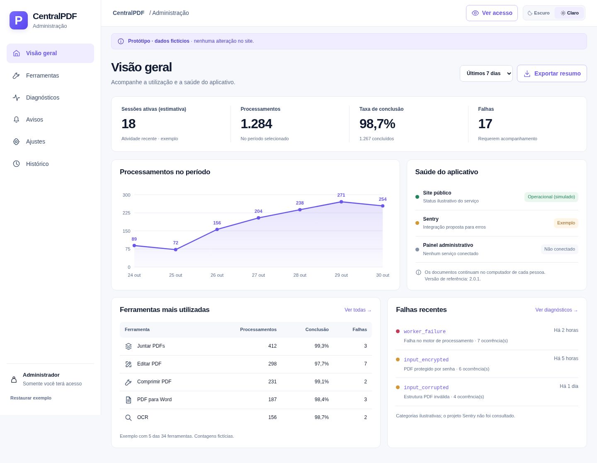

# Gerenciador CentralPDF — proposta para avaliação

Esta entrega contém **planejamento e exemplo**, sem implantação de serviços ou
alterações no site público. O login será exclusivo do administrador; os colegas
continuarão utilizando o app sem cadastro.

- [Plano completo](PLANO.md): objetivos, benefícios, escopo, arquitetura,
  privacidade, segurança, fases, testes, custos e decisões pendentes.
- [Plano em PDF](PLANO.pdf): versão de leitura com 6 páginas.
- [Baixar o pacote de avaliação](<CentralPDF — exemplo do gerenciador.zip>): extraia
  e abra o HTML no navegador; inclui o plano em PDF e instruções.
- [Exemplo navegável — código e instruções](../../../examples/admin-demo/README.md):
  arquivo único, sem instalação nem serviços externos.
- [Evidência da avaliação local de capacidade](capacidade-local.json): 37 sessões
  sintéticas, em rodadas de até 20; não é um limite de produção.
- [Conceito visual](referencia.png): imagem de referência, também com números fictícios.

O exemplo tem Visão geral, Ferramentas, Diagnósticos, Avisos, Ajustes e Histórico.
Permite alternar tema/período, buscar ferramentas, baixar CSV fictício, examinar
falhas e simular avisos. Nenhuma dessas ações grava dados no servidor. A prévia
publicada e o rascunho são separados: salvar um rascunho não publica a mensagem.

**Todos os indicadores são demonstrativos.** O estado dos serviços não foi obtido
por conexão real. Os campos de acesso estão desabilitados; não informe senhas.
A autenticação e os controles reais dependem de uma etapa futura aprovada.

A imagem gerada orientou a composição e as cores. O exemplo reutiliza o controle
único de tema já adotado pelo CentralPDF, usa texto explícito de serviços não
conectados e calcula os indicadores a partir do conjunto fictício. A versão para
celular reorganiza o conteúdo em coluna e ajusta a legibilidade do gráfico.

## Aparência do exemplo

Captura real do HTML navegável. Todos os números são fictícios e os serviços não
estão conectados.

A validação usa `python scripts/run-browser-test.py tests/admin-demo.test.py`,
com Chromium/Firefox, desktop/celular, CSV, filtros, rascunho/publicação separados,
preferências, histórico, acesso ilustrativo e abertura do HTML offline.
