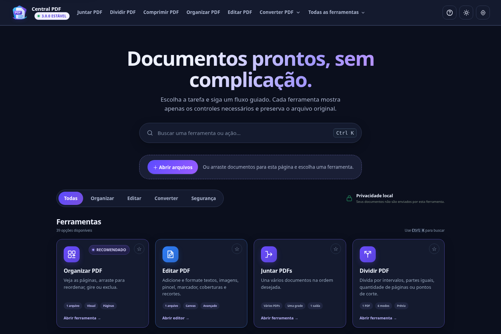

# Central PDF 3.0.0

A versão 3.0 reúne a nova identidade visual, melhorias no Admin e uma leitura de
arquivos mais clara, preservando **34 módulos reais e 39 atalhos**. PDFs, imagens
e documentos Office continuam sendo processados no dispositivo.

## Novidades

- **Interface renovada:** busca e filtros arredondados, cartões com destaque uniforme ao passar o mouse ou usar o teclado e botões com relevo discreto nos dois temas.
- **Leitura acompanhada:** anel roxo fino, etapa real, tamanho do lote e tempo decorrido, com ajuda expansível e suporte a movimento reduzido.
- **PDF.js 6.5.438:** API, worker e recursos locais sincronizados e verificados por hash, incluindo compatibilidade da edição de texto original.
- **PDFs sem senha de abertura:** arquivos que abrem normalmente, mas têm restrições de edição, deixam de ser rejeitados como se exigissem senha. Uma senha verdadeira continua necessária.
- **Renomeação fiel:** Classificar e renomear preserva os bytes originais dos PDFs no ZIP, incluindo criptografia e estruturas de assinatura.
- **Admin mais organizado:** versão compacta, horário da última consulta bem-sucedida e filtro de ferramentas com falhas. Segurança com senha/MFA e limites gratuitos preservados.
- **Celular e acessibilidade:** ajustes de sobreposição, área administrativa separada do consentimento, foco visível e configurações adaptadas a telas menores.
- **Continuidade:** projetos e preferências preservados, cache atualizado para `pages-54` e pacote Windows com os motores offline preparados.



## Baixar e usar no Windows

1. Baixe **CentralPDF_Web_Local_v3.0.0.zip** nos arquivos desta release.
2. Extraia **todo o conteúdo** para uma pasta comum. Não execute de dentro do ZIP.
3. Abra **ABRIR_CENTRAL_PDF.bat** e utilize o aplicativo no navegador.
4. Preserve a pasta completa: o executável separado também depende dos arquivos e motores do pacote.

O pacote inclui o servidor Windows de 64 bits, a aplicação original e os motores
PDF/Office/OCR preparados. Não precisa instalar Node.js ou Python para usar.
O site público continua disponível em
[CentralPDF](https://misaeldasilva123ms96-commits.github.io/CentralPDF_Web_Local/).
O Admin tem publicação própria; a release Windows não instala nem atualiza o painel hospedado.

### Integridade e proveniência

Compare o hash do download com **CentralPDF_Web_Local_v3.0.0.sha256**:

```powershell
Get-FileHash .\CentralPDF_Web_Local_v3.0.0.zip -Algorithm SHA256
```

A automação reconstrói o executável com Go 1.26.10, compara com o binário versionado,
verifica os motores e gera checksums e atestações de proveniência dos artefatos.

## Validação

- 86 arquivos de teste Python na aplicação original, além das verificações JavaScript.
- 241 testes da interface React e 27 testes do Admin, com builds aprovados.
- Fluxos reais em Chromium e Firefox, computador/celular, 34 workspaces, 39 atalhos e seis larguras nos dois temas.
- PDF sintético com cerca de 16 MB: importação e exportação com texto, dimensões e pixels idênticos.
- Verificações de pacote preparado, recarga offline, Office, edição nativa, assinatura, senhas e reprodução do executável Windows.

[Relatório e capturas](https://github.com/misaeldasilva123ms96-commits/CentralPDF_Web_Local/blob/v3.0.0/docs/testing/release-3-final/README.md)
· [Guia administrativo](https://github.com/misaeldasilva123ms96-commits/CentralPDF_Web_Local/blob/v3.0.0/admin/README.md)
· [Histórico completo](https://github.com/misaeldasilva123ms96-commits/CentralPDF_Web_Local/blob/v3.0.0/CHANGELOG.md)

## Compatibilidade e limites

Arquivos grandes podem exigir bastante memória; o indicador não garante o mesmo
tempo em todos os computadores. Conversões Office dependem de fontes e layout;
revise o resultado antes de compartilhar. A interface React permanece uma migração
parcial e não substitui os 34 módulos da aplicação original.

As ferramentas não enviam documentos ao servidor da aplicação. Compartilhamento
de diagnósticos e estatísticas segue as preferências configuráveis de cada navegador.
Uma assinatura digital pode perder validade quando o conteúdo do PDF é alterado;
renomear uma cópia sem regravar o PDF preserva seus bytes.

Não apague projetos ou preferências para atualizar. Abas instaladas/offline
precisam reconectar para receber a revisão do site. Uma instalação Windows antiga
precisa ser substituída pela pasta completa desta versão.
