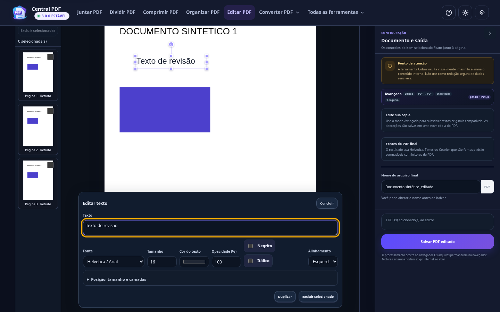
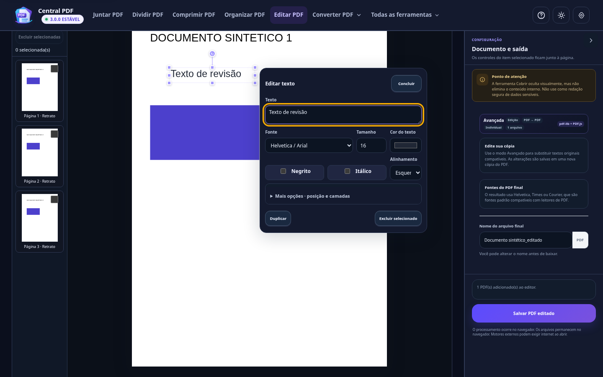
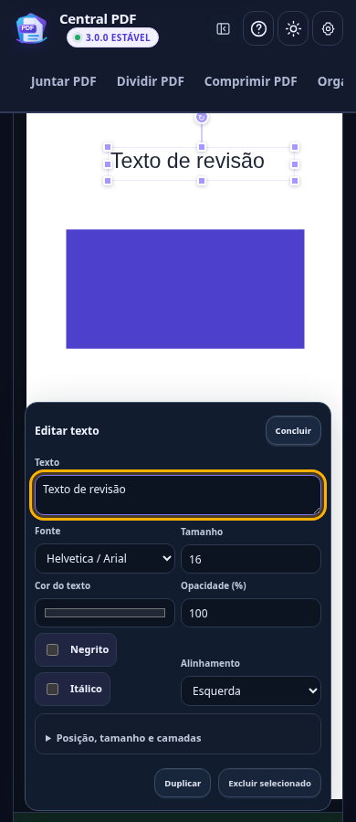
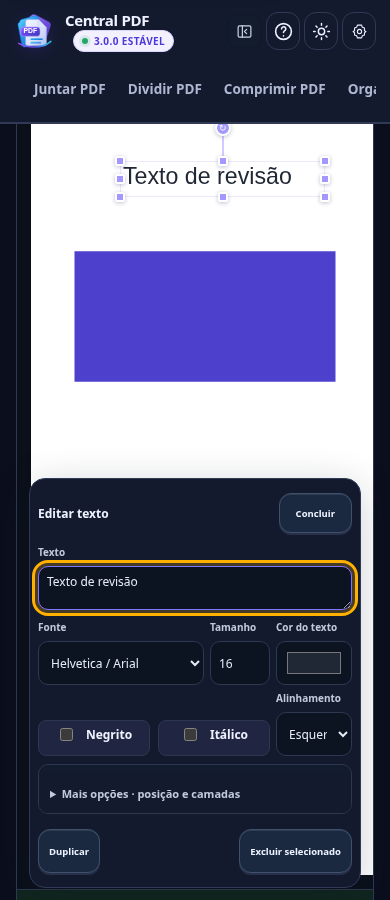
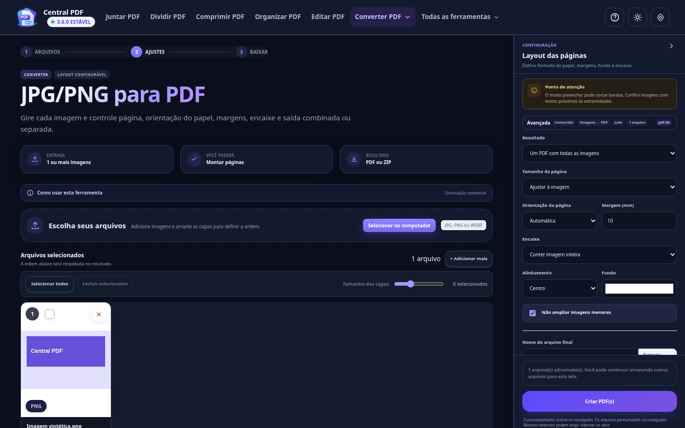
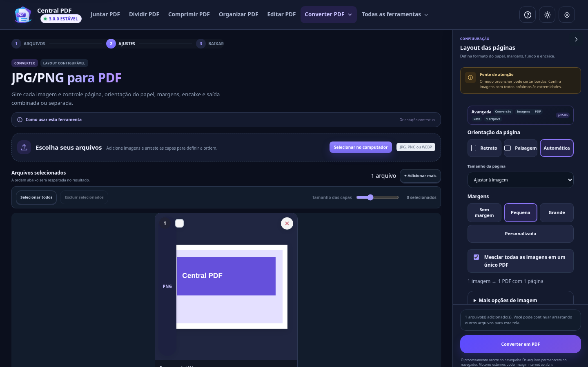
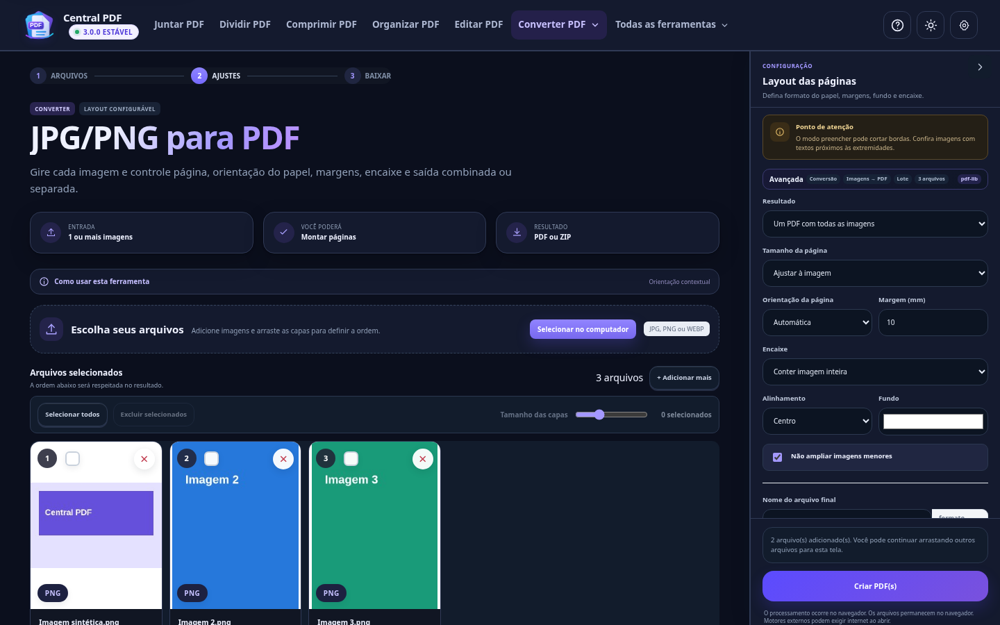
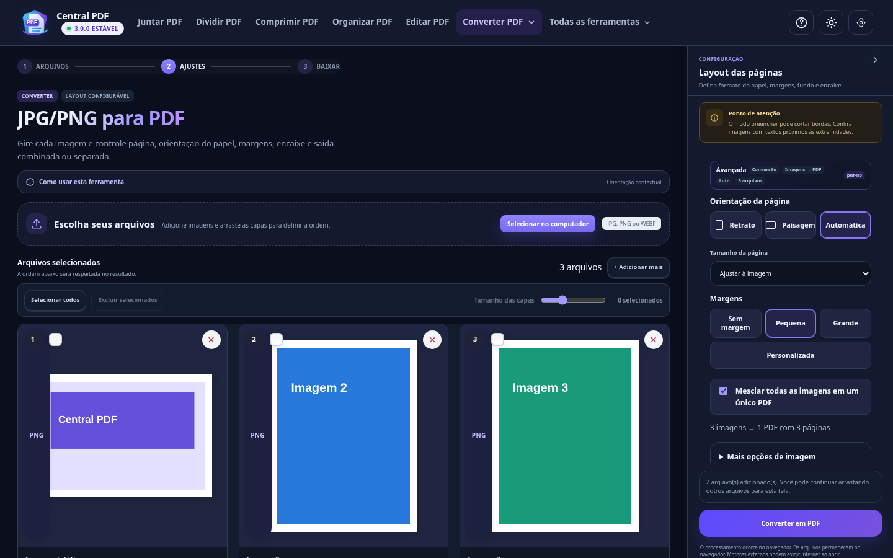
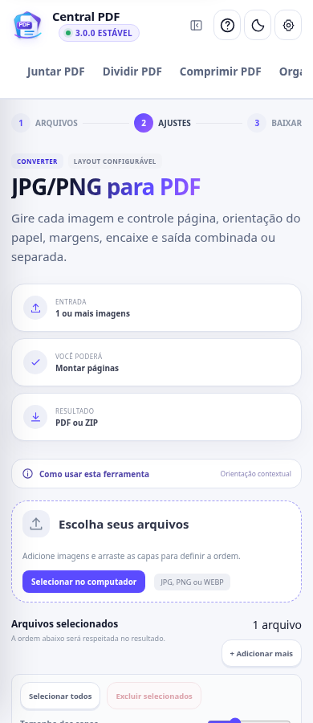
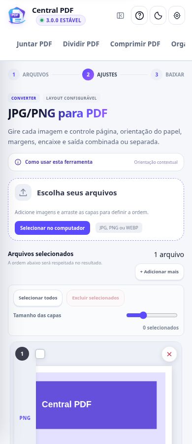

# Prévia para aprovação — Central PDF 3.0

Esta prévia usa o aplicativo real da raiz. As ferramentas, uploads e arquivos exportados são reais. A migração React não substitui o site. Nada foi integrado à main, publicado em Pages/Cloudflare ou lançado como release.

PRs em rascunho: [#89 — fundamentos, editor e imagens](https://github.com/misaeldasilva123ms96-commits/CentralPDF_Web_Local/pull/89) e [#90 — catálogo e homologação](https://github.com/misaeldasilva123ms96-commits/CentralPDF_Web_Local/pull/90). A #90 contém o conjunto completo e depende da #89.

## Abrir e experimentar

Nesta sessão, uma cópia isolada com motores preparados é servida em **http://127.0.0.1:8865/**. Esse endereço pertence ao ambiente de trabalho; não é URL pública nem endereço do site de produção. Se o cliente Codex não expuser a porta, execute a branch localmente.

No Windows, use uma pasta nova para evitar misturar arquivos de trabalho:

```powershell
git clone --single-branch --branch feat/ux-simple-all-tools https://github.com/misaeldasilva123ms96-commits/CentralPDF_Web_Local.git CentralPDF-UX-Preview
cd CentralPDF-UX-Preview
.\PREPARAR_OFFLINE.bat
.\ABRIR_CENTRAL_PDF.bat
```

A preparação baixa/verifica os motores oficiais e mantém os documentos no computador. Não precisa de conta administrativa do Central PDF, Supabase ou token. Não use o deploy de produção para experimentar.

Se a cópia já estiver com motores preparados e houver Python disponível:

```bash
python -m http.server 8865 --bind 127.0.0.1
```

O servidor Python serve os arquivos e não reproduz todos os cabeçalhos do servidor Go. No Windows, prefira o inicializador do produto. Para Linux/Codex, use a cópia preparada da sessão; o uso offline/Office foi verificado também pelos testes do pacote preparado.

## Editor — antes / depois

| Antes | Depois |
| --- | --- |
|  |  |
|  |  |

O balão passa de até 760 px para alvo de 400 px, limitado pela janela. Texto, fonte, tamanho, cor, negrito, itálico, alinhamento e Concluir ficam à vista. **Mais opções · posição e camadas** contém opacidade, geometria, rotação, alinhamento na página e camadas. Duplicar/Excluir, seleção, histórico e imagens continuam disponíveis. As propriedades da imagem ficam no fluxo acima da página.

Roteiro: abra Editar PDF, importe um PDF de teste, adicione texto, mude fonte/tamanho/cor/estilos e abra Mais opções. Ajuste opacidade e posição, duplique, desfaça/refaça, conclua e salve. Reabra o PDF e confira o original e o texto novo. No modo Avançado, teste o texto nativo compatível; os avisos sobre fontes e cobertura visual permanecem.

## JPG/PNG para PDF — antes / depois

| Antes | Depois |
| --- | --- |
|  |  |
|  |  |
|  |  |

Orientação tem escolhas visuais para Retrato/Paisagem e mantém Automática. Os quatro tamanhos anteriores continuam disponíveis: Ajustar à imagem, A4, Carta e Personalizado. Margens: Sem margem = 0 mm, Pequena = 10 mm, Grande = 20 mm; **Personalizada** abre o valor livre em mm. O controle de tamanho das miniaturas continua funcionando.

A opção de mesclar controla o seletor original: ligada gera um PDF com todas as páginas; desligada gera um PDF individual ou ZIP com vários PDFs. **Mais opções de imagem** mantém também o seletor original de saída/orientação, margem numérica, encaixe, alinhamento, fundo e não ampliar. A indicação “prévia aproximada” explica o alcance da visualização de papel/margens.

Roteiro: importe JPG, PNG transparente e WEBP; acrescente imagens, gire e reordene. Alterne orientação, A4/Carta/personalizado e margens. Teste os extremos do tamanho de miniaturas. Desligue Mesclar e confira o resumo de saída; converta e abra os PDFs/ZIP. Mude a cor de fundo com PNG transparente e confira a saída real.

## Exemplos das demais ferramentas

| Ferramenta | Captura final |
| --- | --- |
| Juntar | [Desktop escuro](evidence/after/merge-chromium-1440-dark.png) · [Celular claro](evidence/after/merge-chromium-390-light.png) |
| Dividir | [Desktop claro](evidence/after/split-chromium-1440-light.png) · [Celular escuro](evidence/after/split-chromium-390-dark.png) |
| Organizar | [Desktop escuro](evidence/after/organize-chromium-1440-dark.png) · [Celular claro](evidence/after/organize-chromium-390-light.png) |
| Comprimir | [Desktop claro](evidence/after/compress-chromium-1440-light.png) |
| OCR | [Desktop escuro](evidence/after/ocr-chromium-1440-dark.png) · [Celular claro](evidence/after/ocr-chromium-390-light.png) |
| Assinar | [Desktop claro](evidence/after/signPdf-chromium-1440-light.png) |
| Marca-d’água | [Desktop claro](evidence/after/watermark-chromium-1440-light.png) |
| Home preservada | [Desktop escuro](evidence/after/home-1440-dark.png) · [Celular claro](evidence/after/home-390-light.png) |

As capturas usam documentos e imagens sintéticos. Os demais estados de importação/layout estão na matriz de 816 casos; não são uma promessa de que todos os casos possíveis de documentos foram cobertos.

## Conferência funcional e limites

Veja o [inventário anterior](INVENTARIO_E_GAPS.md), o [relatório por ferramenta](TESTES_E_PARIDADE.md) e os [checkpoints](CHECKPOINTS.md). Foram preservadas 34 famílias e 39 atalhos, processamento local, projetos, preferências, resultados e offline. Auth/MFA/API/Worker/banco do Admin não foram alterados; somente a referência gerada de cache acompanha o app.

Experimente também teclado/Tab/Esc, claro/escuro, a preferência Compacto, projetos e resultados. Toque físico, teclado virtual, leitor de tela e zoom nativo de 200% permanecem como conferência humana; a emulação de telas não substitui esses testes.

Para reproduzir as capturas com uma cópia preparada:

```bash
python scripts/capture-ux-simplification.py --site CAMINHO_DA_COPIA_PREPARADA --phase after
```

**Avaliação solicitada:** confira o tamanho do balão, a legibilidade, o espaço dado ao documento, o acesso a Mais opções e a facilidade de converter imagens. Você aprova o visual e o fluxo para prosseguirmos ao merge? A integração e a publicação dependem da sua autorização.
